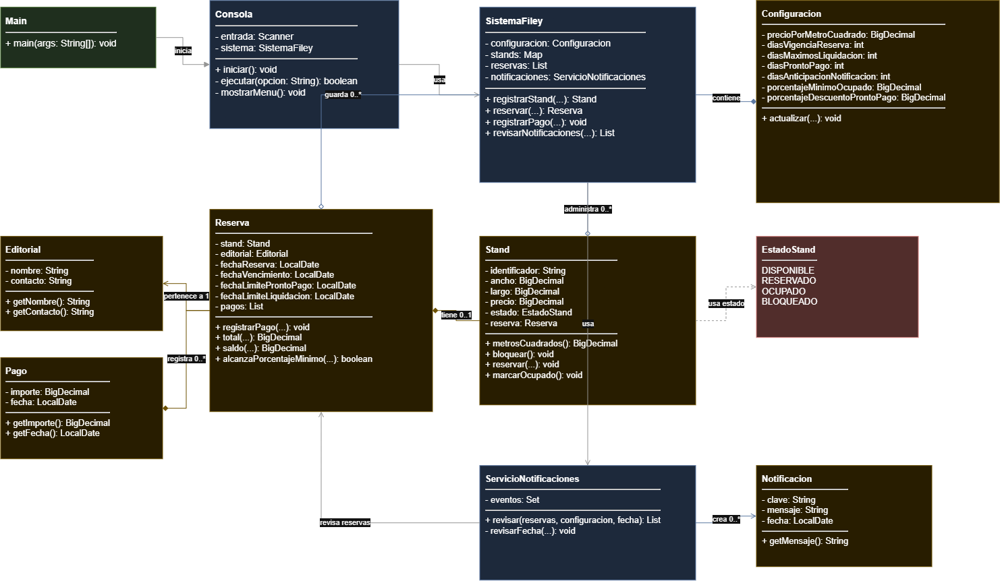

# Sistema Administrativo de Stands FILEY

Aplicación de consola en Java para administrar stands de la Feria Internacional de la Lectura Yucatán (FILEY). Permite configurar costos y plazos, registrar espacios, reservarlos para editoriales, controlar pagos y consultar notificaciones.

## Actores

- **Administrador:** configura las reglas de operación, registra stands, bloquea o desbloquea espacios y consulta su estado.
- **Personal de ventas:** registra reservas y pagos de las editoriales y revisa sus saldos y notificaciones.

## Historias de usuario

### HU-01: Configurar costos y plazos

Como administrador, quiero configurar el precio por metro cuadrado, los plazos de reserva y liquidación y los porcentajes de pago y descuento, para adaptar el sistema a las condiciones de la feria.

**Criterios de aceptación:** los importes deben ser positivos, los porcentajes deben estar entre 0 y 100 y el plazo de liquidación debe cubrir la vigencia de la reserva.

### HU-02: Registrar un stand

Como administrador, quiero registrar un stand con identificador y dimensiones, para conocer automáticamente su área y precio.

**Criterios de aceptación:** el identificador no puede estar vacío ni repetido; las dimensiones deben ser positivas; el sistema calcula el área y multiplica por el precio configurado por metro cuadrado.

### HU-03: Consultar disponibilidad

Como personal de ventas, quiero ver los stands y su estado, para ofrecer únicamente los espacios disponibles y dar seguimiento a los reservados u ocupados.

**Criterios de aceptación:** el listado muestra identificador, estado, área y precio; si existe una reserva, también muestra la editorial, lo pagado y el saldo.

### HU-04: Reservar un stand

Como personal de ventas, quiero asociar un stand disponible con una editorial, para apartar el espacio durante el plazo configurado.

**Criterios de aceptación:** el stand debe existir y estar disponible; se solicitan nombre y contacto de la editorial y fecha de reserva; el sistema calcula y muestra la fecha de vencimiento.

### HU-05: Controlar espacios bloqueados

Como administrador, quiero bloquear o desbloquear stands y convertir un stand bloqueado en una reserva, para gestionar espacios que requieren atención administrativa.

**Criterios de aceptación:** solo se bloquean stands disponibles; solo se desbloquean stands bloqueados; la opción de transferencia acepta únicamente un stand bloqueado.

### HU-06: Registrar pagos

Como personal de ventas, quiero registrar pagos de una reserva, para actualizar el saldo y el estado del stand.

**Criterios de aceptación:** el stand debe tener una reserva, el pago debe ser positivo y no puede superar el saldo pendiente; se aplica el descuento de pronto pago cuando corresponda; al alcanzar el porcentaje mínimo configurado, el stand cambia a ocupado.

### HU-07: Revisar notificaciones

Como personal de ventas, quiero consultar avisos de vencimiento de reservas, descuentos y liquidaciones, para dar seguimiento oportuno a las editoriales.

**Criterios de aceptación:** se muestran avisos dentro del periodo de anticipación configurado y el mismo evento no se repite en revisiones posteriores.

## Casos de uso

### CU-01: Registrar stand

- **Actor:** administrador.
- **Precondición:** el sistema está iniciado y existe una configuración válida de precio por metro cuadrado.
- **Flujo principal:** el actor elige **Registrar stand**, captura identificador, ancho y largo; el sistema valida los datos, calcula área y precio y confirma el registro.
- **Alternativas:** si falta el identificador, una dimensión no es positiva o el identificador ya existe, el sistema informa el error y no registra el stand.
- **Postcondición:** el stand queda disponible en el sistema.

### CU-02: Reservar stand

- **Actor:** personal de ventas.
- **Precondición:** existe un stand disponible.
- **Flujo principal:** el actor elige **Reservar stand**, captura el identificador, nombre y contacto de la editorial y fecha; el sistema crea la reserva y muestra su vencimiento.
- **Alternativas:** si el stand no existe o no está disponible, el sistema informa el error y no crea la reserva.
- **Postcondición:** el stand queda reservado y asociado a la editorial.

### CU-03: Registrar pago

- **Actor:** personal de ventas.
- **Precondición:** existe una reserva para el stand.
- **Flujo principal:** el actor elige **Registrar pago**, captura identificador, importe y fecha; el sistema valida el importe y fecha, registra el pago y actualiza el estado si se alcanza el porcentaje mínimo.
- **Alternativas:** si no hay reserva, el pago no es positivo, excede el saldo o rebasa la fecha límite de liquidación, el sistema informa el error.
- **Postcondición:** el pago queda asociado a la reserva y el saldo puede consultarse en el listado.

### CU-04: Revisar notificaciones

- **Actor:** administrador o personal de ventas.
- **Precondición:** hay reservas registradas.
- **Flujo principal:** el actor elige **Revisar notificaciones**; el sistema compara las fechas límite con la fecha actual y muestra avisos próximos dentro del periodo configurado.
- **Alternativa:** si no hay avisos nuevos, el sistema lo indica; no repite eventos ya notificados.
- **Postcondición:** los avisos nuevos quedan marcados internamente para evitar duplicados.

## Abstracción y responsabilidades

El modelo representa conceptos y reglas del dominio FILEY, mientras la interfaz de consola se encarga de la interacción. Esta separación permite modificar el menú sin trasladar las reglas del negocio a la interfaz.

| Clase | Responsabilidad |
|---|---|
| `Main` | Iniciar la aplicación. |
| `Consola` | Mostrar el menú, leer y validar entradas de formato, invocar operaciones y presentar resultados. |
| `SistemaFiley` | Coordinar configuración, stands, reservas, pagos y revisión de notificaciones. |
| `Stand` | Representar un espacio, calcular área y precio y controlar sus cambios de estado. |
| `Reserva` | Asociar stand y editorial, calcular fechas límite, pagos, descuento, saldo y porcentaje pagado. |
| `Editorial` | Representar el nombre y contacto de la editorial. |
| `Pago` | Representar el importe y la fecha de un pago. |
| `Configuracion` | Mantener y validar costos, plazos y porcentajes del sistema. |
| `ServicioNotificaciones` | Detectar vencimientos próximos y evitar notificar dos veces el mismo evento. |
| `Notificacion` | Representar una notificación con clave, mensaje y fecha. |
| `EstadoStand` | Enumerar los estados posibles de un stand. |

## Diagrama de clases

El diagrama del modelo se encuentra en [`docs/diagrama-clases.md`](docs/diagrama-clases.md) y su versión gráfica en [`docs/diagrama-clases.drawio.png`](docs/diagrama-clases.drawio.png).



Los requisitos funcionales y no funcionales completos están en [`requisitos.md`](requisitos.md).

## Video de evidencia

[Ver video de evidencia](https://drive.google.com/file/d/1vz3OkuADlqTC0_AsTgAkjYvMWaonDwLU/view?usp=sharing)

## Compilar y ejecutar

Requisitos: JDK instalado y los comandos `javac` y `java` disponibles en la terminal.

Desde la raíz del repositorio, en PowerShell:

```powershell
New-Item -ItemType Directory -Force out
javac -d out (Get-ChildItem -Recurse -Filter *.java src/main/java | ForEach-Object FullName)
java -cp out com.filey.Main
```

El menú permite configurar costos y plazos, registrar y consultar stands, reservar, bloquear y desbloquear, transferir un stand bloqueado a reserva, registrar pagos y consultar notificaciones.
