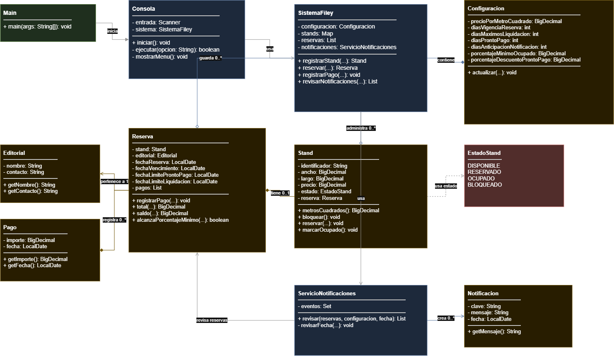

# Sistema Administrativo de Stands FILEY

Aplicación de consola en Java para administrar stands, reservas, pagos, descuentos y notificaciones.


## Diagrama de clases



### Compilar y ejecutar

```powershell
New-Item -ItemType Directory -Force out
javac -d out (Get-ChildItem -Recurse -Filter *.java src/main/java | ForEach-Object FullName)
java -cp out com.filey.Main
```
